<div align="center">

# 🌍 Earthquake Monitor and Alerting System Using STM32

**Interrupt-driven vibration detection with a local alarm, an LCD menu and SMS alerts over GSM**


<br/><br/>

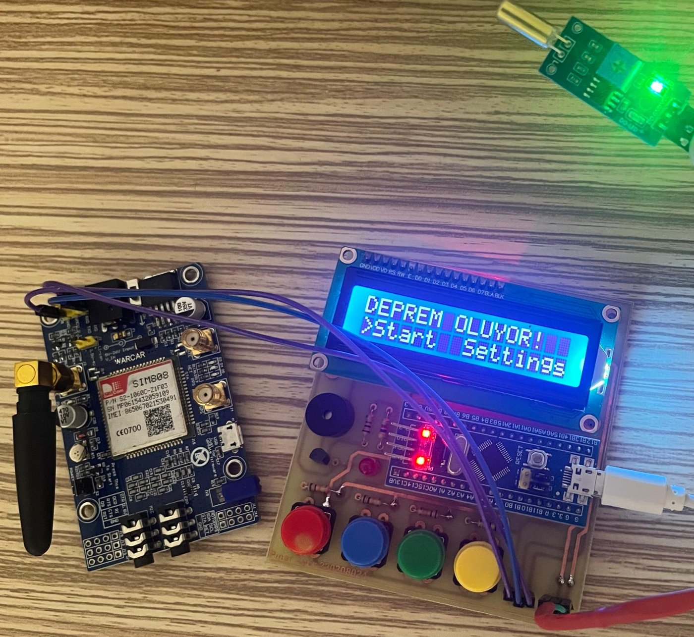

<sub><i>Alarm state: the tilt/vibration sensor fires, the LCD shows <b>"DEPREM OLUYOR!"</b> ("Earthquake!") and the LED and buzzer turn on.</i></sub>

</div>

---

## 📌 Overview

This project is an earthquake early-warning prototype built around an **STM32F103C8T6 (Blue Pill)**. A vibration/tilt sensor is wired to an **external interrupt**, so the microcontroller reacts to shaking without constantly polling it. When shaking is detected, the system:

1. 🔴 switches on a **red LED** and a **buzzer**,
2. 📟 shows **"DEPREM OLUYOR!"** on a **16x2 I2C LCD**,
3. 📱 sends a **"Deprem algilandi!"** ("Earthquake detected!") **SMS** through a **SIM800 GSM module** using AT commands.

When the shaking stops, the system returns to **"Guvenli Mod"** (safe mode) by itself. A four-button menu on the LCD lets the user move between screens and choose the alert number.

The custom carrier board (schematic and PCB) was designed in **KiCad** and manufactured as a single-layer board.

---

## ✨ Features

| | Feature | How it works |
|---|---|---|
| ⚡ | **Interrupt-based detection** | Sensor on `PA0` → `EXTI0`, rising edge. The ISR only records a timestamp, so the interrupt stays very short. |
| ⏱️ | **Alarm hold and auto-reset** | The alarm stays on for at least **1.5 s** after the last pulse and clears after **0.5 s** of quiet. |
| 📱 | **SMS alert** | `AT+CMGF=1` → `AT+CMGS="<number>"` → message → `Ctrl+Z` over USART1 at 9600 baud. **Only one SMS is sent per event**, so a long earthquake does not flood the phone. |
| 📟 | **I2C LCD driver** | A small, self-written driver for an HD44780 LCD behind a PCF8574 I2C expander (4-bit mode, address `0x27`). |
| 🎛️ | **Menu state machine** | `BOOT → MAIN (Start / Settings) → START / SETTINGS (Num1 / Num2)`. |
| 🔘 | **Debounced buttons** | Rising-edge detection with **120 ms** software debounce; each press is turned into a single event flag. |
| 🔊 | **Buzzer driver** | The buzzer is switched through a **BC547** transistor, so the GPIO pin is not loaded directly. |

---

## 🖼️ Gallery

<table>
<tr>
<td width="50%" align="center">
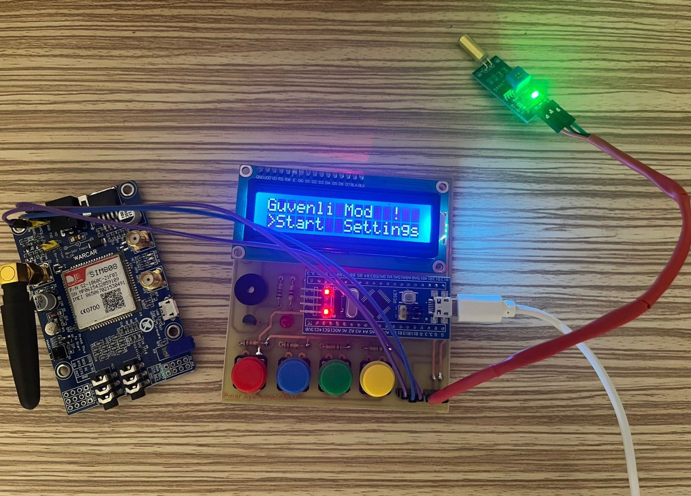<br/>
<sub><b>Safe mode</b>: no vibration, system waiting</sub>
</td>
<td width="50%" align="center">
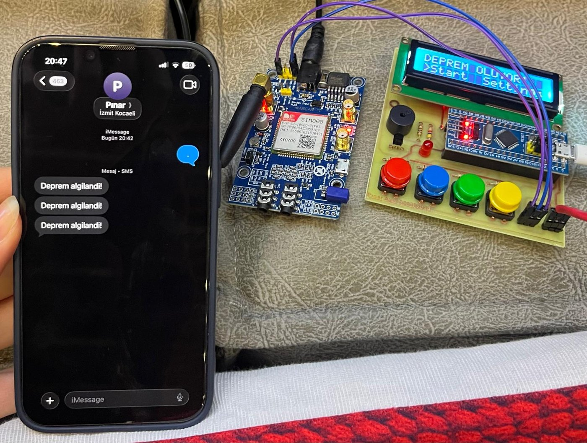<br/>
<sub><b>SMS received</b>: "Deprem algilandi!" on the phone</sub>
</td>
</tr>
<tr>
<td width="50%" align="center">
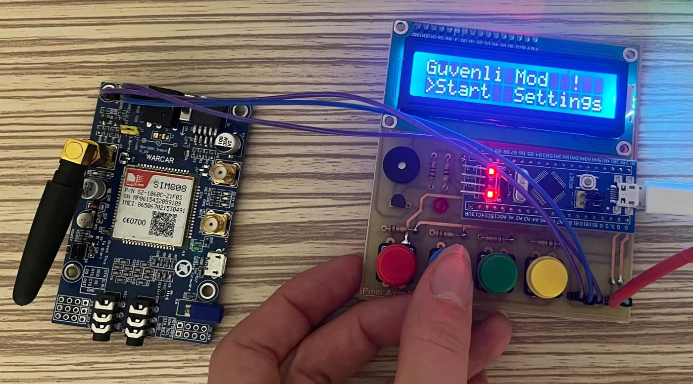<br/>
<sub><b>Main menu</b>: <code>&gt;Start</code> selected</sub>
</td>
<td width="50%" align="center">
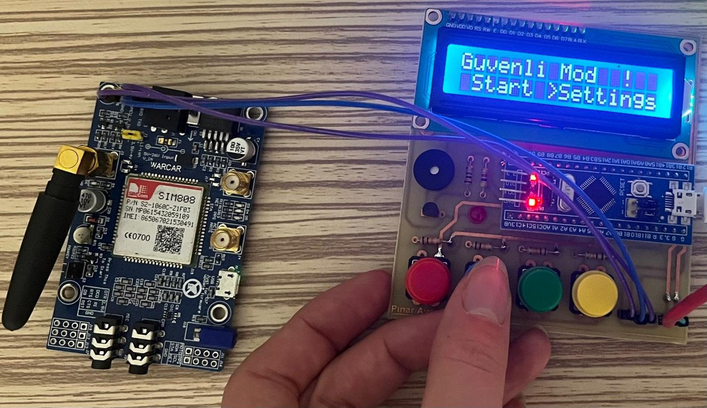<br/>
<sub><b>Main menu</b>: <code>&gt;Settings</code> selected</sub>
</td>
</tr>
<tr>
<td width="50%" align="center">
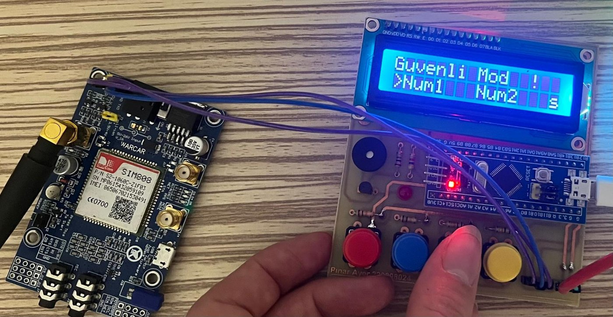<br/>
<sub><b>Settings</b>: choosing the alert number (Num1 / Num2)</sub>
</td>
<td width="50%" align="center">
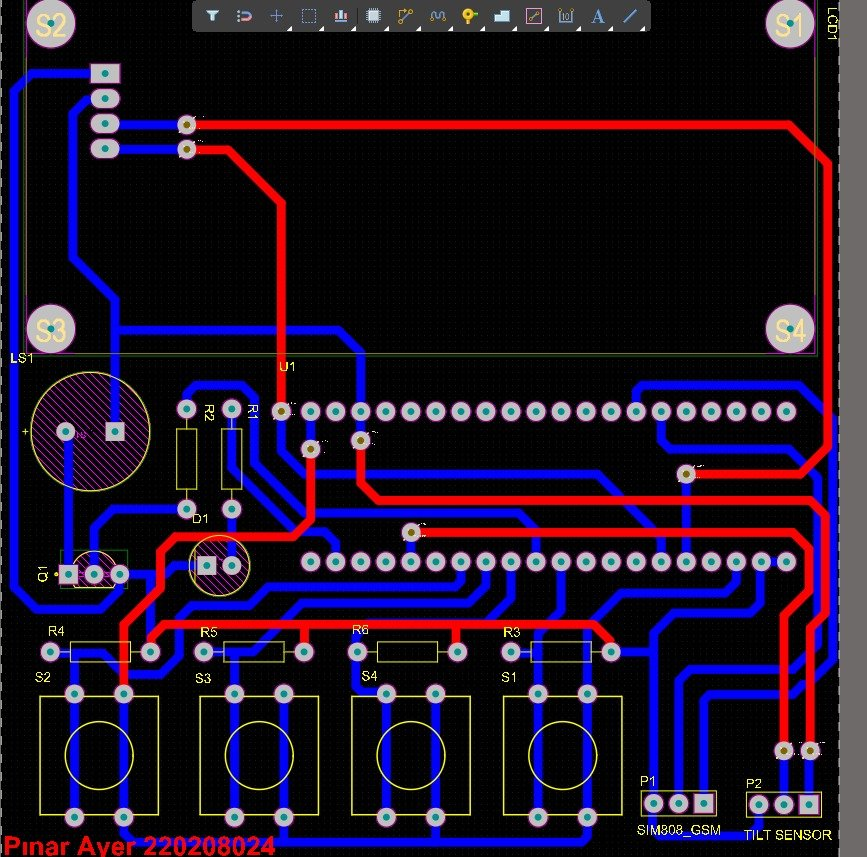<br/>
<sub><b>PCB layout</b> designed in KiCad</sub>
</td>
</tr>
</table>

### 📐 Schematic

<div align="center">
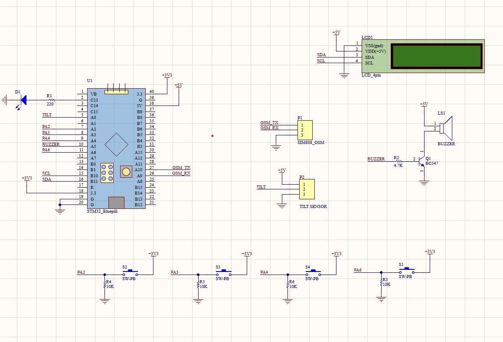
</div>

---

## 🧩 System Architecture

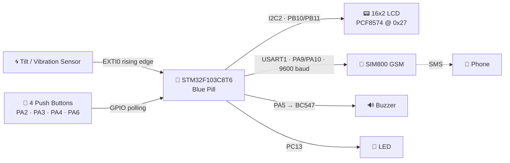

### Detection logic

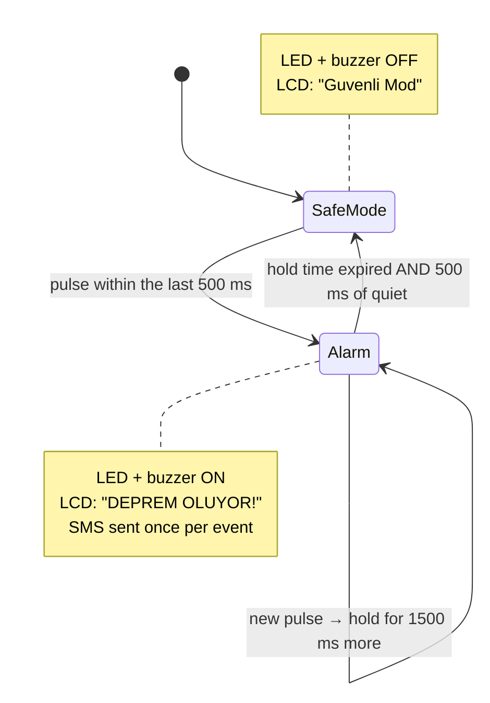

### Menu flow

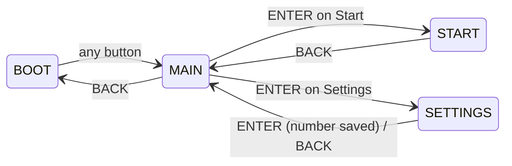

---

## 🔌 Pin Map

| STM32 Pin | Peripheral | Connected to |
|:---:|:---:|---|
| `PA0` | EXTI0 (rising, pull-up) | Tilt / vibration sensor |
| `PA2` | GPIO input | Button: UP |
| `PA3` | GPIO input | Button: DOWN |
| `PA4` | GPIO input | Button: ENTER |
| `PA6` | GPIO input | Button: BACK |
| `PA5` | GPIO output | Buzzer (through BC547) |
| `PC13` | GPIO output | Status LED |
| `PB10` / `PB11` | I2C2 SCL / SDA (100 kHz) | 16x2 LCD + PCF8574 |
| `PA9` / `PA10` | USART1 TX / RX (9600 8N1) | SIM800 GSM RX / TX |

---

## 🛠️ Hardware

- STM32F103C8T6 "Blue Pill" development board
- SIM800 GSM module with antenna and an active SIM card
- Tilt / vibration sensor module
- 16x2 character LCD with a PCF8574 I2C backpack
- Active buzzer + BC547 NPN transistor
- 4 × tactile push buttons with 10 kΩ pull-down resistors
- LED + current-limiting resistor
- Custom single-layer PCB (KiCad)

---

## 💻 Code Highlights

**Short ISR: only a timestamp is stored**
```c
void HAL_GPIO_EXTI_Callback(uint16_t GPIO_Pin)
{
    if (GPIO_Pin == GPIO_PIN_0) {
        lastPulseMs = millis();
    }
}
```

**Alarm hold / auto-reset logic in the main loop**
```c
if (sincePulse < QUIET_TO_SAFE_MS) {        // shaking right now
    alarmOn();
    alarmUntil = now + HOLD_TIME_MS;         // keep alarm for 1.5 s
    quietAccum = 0;
} else {
    quietAccum += dt;                        // count quiet time
}
if ((now > alarmUntil) && (quietAccum >= QUIET_TO_SAFE_MS)) {
    alarmOff();                              // back to safe mode
}
```

**Sending an SMS with AT commands**
```c
HAL_UART_Transmit(&huart1, "AT+CMGF=1\r\n", ...);          // text mode
HAL_UART_Transmit(&huart1, "AT+CMGS=\"+90XXXXXXXXXX\"\r\n", ...);
HAL_UART_Transmit(&huart1, "Deprem algilandi!", ...);
HAL_UART_Transmit(&huart1, &ctrlZ /* 0x1A */, 1, ...);      // send
```

---

## 📁 Project Structure

```
earthquake-sms-alert/
├── Core/
│   ├── Inc/            # main.h, HAL config, interrupt headers
│   ├── Src/
│   │   ├── main.c      # application: sensor, alarm, LCD, menu, GSM
│   │   └── stm32f1xx_it.c
│   └── Startup/
├── Drivers/            # STM32 HAL + CMSIS
├── images/             # photos, schematic and PCB
├── muhtasp2.ioc        # STM32CubeMX pin / clock configuration
└── STM32F103C8TX_FLASH.ld
```

---

## 🚀 Getting Started

1. Clone the repository and open the folder in **STM32CubeIDE** (*File → Open Projects from File System*).
2. In `Core/Src/main.c`, write your own phone number:
   ```c
   const char* ALERT_PHONE = "+90XXXXXXXXXX";
   ```
3. Build the project and flash it with an **ST-Link**.
4. Insert a SIM card into the SIM800 module and power it from a supply that can deliver its current peaks (up to ~2 A).
5. Shake or tilt the sensor and watch the alarm, the LCD and your phone. 📱

---

## 🔭 Future Improvements

- [ ] Send the SMS to the number chosen in the **Num1 / Num2** settings menu
- [ ] Read the GSM module's response (`OK` / `+CMGS`) and show a real **"GSM Connected"** status
- [ ] Replace the tilt sensor with an **accelerometer** (e.g. MPU6050) to measure shaking intensity
- [ ] Replace blocking `HAL_Delay` calls in the SMS routine with a non-blocking state machine

---

<div align="center">

👩‍💻 Developed by **[Pınar Ayer](https://github.com/Ayer8315)** · Electronics and Communication Engineering, Kocaeli University

</div>
